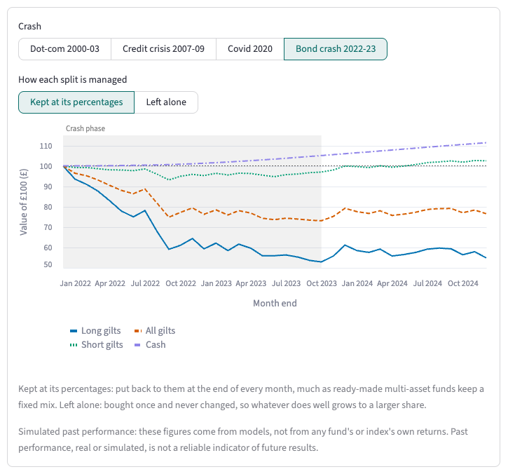
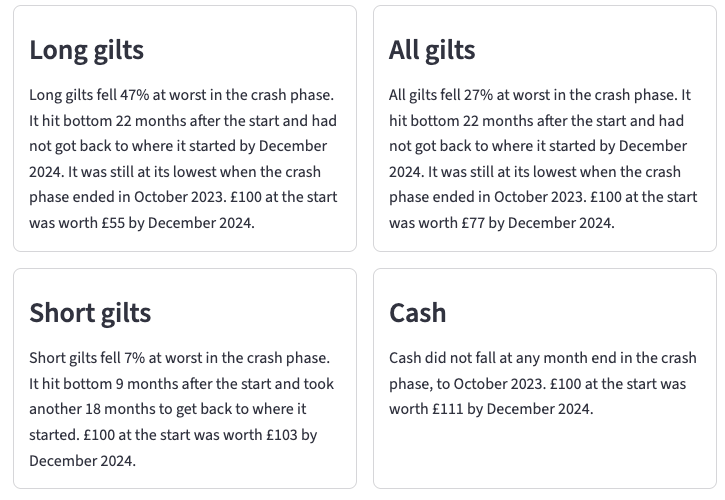
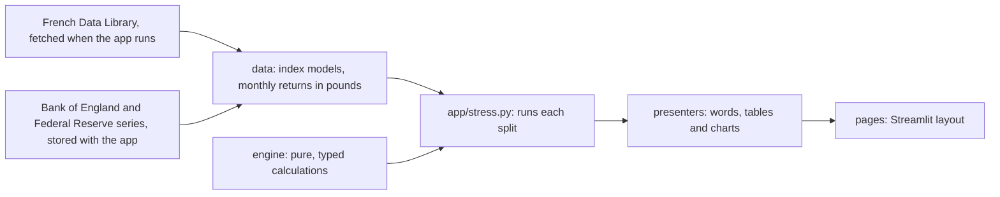

# Portfolio crash modeller

**How would your investments have coped with a crash?** Build splits of real UK index funds and
ETFs, and see how each would have come through four real market crashes, in pounds, modelled from
open data.

Python 3.12 and Streamlit over a pure, typed engine: about 1,400 tests at 100% branch coverage,
strict mypy, and CI on every push.

[](https://github.com/tomfirth-ai/portfolio-crash-modeller/actions/workflows/ci.yml)

**Try it live:** the link is added here when the app goes public. The free host sleeps when no one
has visited for a while, so the first visit can take a minute to wake it.

**Status:** v0.1. Design and Stress-test are live; deciding on a split and tracking it come next
(see the [roadmap](docs/roadmap.md)).



*Four splits through the 2022-23 bond crash: funds holding long-dated gilts, gilts of every
maturity, short-dated gilts and cash, each modelled from the Bank of England's gilt yield curve and
SONIA.*

> **Not investment advice.** This is a learning and portfolio project. Past performance, real or
> simulated, is not a reliable indicator of future results.

## What it does

1. **Design** up to four splits from real index funds and ETFs from ten fund managers (S&P 500,
   MSCI World, FTSE Developed, FTSE All-World, MSCI ACWI and FTSE Global All Cap trackers, gilt
   funds of every maturity and sterling cash ETFs that track SONIA), or start from four examples.
2. **Stress-test** them side by side through the 2000-03 dot-com crash, the 2007-09 financial
   crisis, the 2020 Covid crash and the 2022-23 bond crash. Each split gets its worst fall, how long
   it took to reach its low and to get back, and what £100 became, with a story in words: which
   holdings drove the fall and what the pound's moves against the dollar did. A switch shows every
   split left alone rather than kept at its percentages.
3. **Decide** on one and **track** it month by month: coming next.



## How the figures are made

No index values or fund prices are used: every fund is modelled from the index it tracks, after
the fund's own ongoing charge, typed in from its key information document.

- **Shares** are rebuilt from the Kenneth R. French Data Library's portfolios of companies grouped
  by size, fetched when the app runs and never stored, and turned into pounds at the Federal
  Reserve's month-end exchange rates.
- **Gilts** of all maturities and of over 15 years are a ladder of gilts that keep the coupons
  they were issued with, priced off the Bank of England's yield curve; short-dated gilts are half a
  5-year gilt and half cash. **Cash** earns SONIA, compounded daily.

The app's How it works page explains this in plain words. The reasons for each choice are in the
[decision records](docs/decisions/), and every data source and its licence is in
[DATA_LICENCES.md](DATA_LICENCES.md).

## Engineering highlights

- **A pure engine.** Every financial calculation is a typed function with no I/O, tested against
  hand-worked, round-number figures: yield curves and gilt pricing, rebuilding an index from
  portfolios by size, currency conversion, charges, rebalancing, worst fall and recovery, and which
  holdings drove a fall.
- **Tested end to end.** About 1,400 tests run with network access blocked, with 100% branch
  coverage of everything but the page scripts, which run under Streamlit's AppTest instead. Every
  sentence a visitor can read is checked for British spelling and for wording that could read as
  advice.
- **Data you may publish, and nothing else.** Only openly licensed series are stored, each with its
  source, licence and SHA-256 recorded beside it by a build tool. Restricted data is fetched when
  the app runs, held in memory and never written to disk.
- **Guard rails.** Hooks run strict typing, linting, style, hygiene and a privacy scan before every
  commit, and the privacy scan again before every push. CI runs the same checks except the privacy
  scan, together with the tests and a secret scan of the full history.
- **Decisions on record.** The method is set out in decision records, and the work is planned as
  vertical slices, each tried on the live app before the next.

## How this was built

The project is built with [Claude Code](https://claude.com/claude-code) as the pair programmer,
working under the rules in [CLAUDE.md](CLAUDE.md). The author sets scope through the roadmap and
the decision records, approves each plan before it is built, and tries each slice on the live app;
the hooks and CI hold every change to the same rules on privacy, data licences, types, tests and
style. Commits carry Claude as co-author.

## How the code is laid out



| Folder | What is there |
|---|---|
| [`src/crashmodel/engine/`](src/crashmodel/engine/) | The financial calculations: calendar months, currency conversion, cash and bond returns, zero-coupon yield curves, a ladder of gilts that keep their issue coupons, rebuilding an index from portfolios grouped by company size, fund charges, rebalancing or leaving a split alone, worst fall and recovery, which holdings drove a fall, and the crash windows. |
| [`src/crashmodel/data/`](src/crashmodel/data/) | The open data stored with the app, the runtime fetch of share portfolios, the index models, the catalogue of funds and indexes, and every model's monthly returns in pounds. |
| [`src/crashmodel/app/`](src/crashmodel/app/) | The Streamlit app. `stress.py` runs the visitor's splits through the engine; presenters turn the results into words and are unit tested; pages only lay them out. |
| [`docs/`](docs/) | The roadmap, the decision records and how the privacy guard works. |
| [`tools/`](tools/) | The build tool for the stored data, and the style, hygiene and privacy checks the hooks run. |

## Run it locally

You need [uv](https://docs.astral.sh/uv/), which also installs the right Python.

```sh
uv sync
uv run streamlit run streamlit_app.py
```

## Develop

These are the checks CI runs:

```sh
uv run python -m tools.check_style      # no dash lookalikes, British spelling
uv run python -m tools.check_hygiene    # nothing private, binary or oversized is tracked
uv run ruff check . && uv run ruff format --check .
uv run mypy
uv run pytest --cov                     # network blocked; fails below 100% coverage
```

`uv run pre-commit install` runs all but the tests before every commit, together with a privacy
scan that compares each commit, and every commit you push, with a denylist of the maintainer's
personal details, kept outside the repository. Without a denylist the scan refuses to run, so skip its three hooks with
`SKIP=privacy-staged,privacy-message,privacy-push`. [docs/privacy.md](docs/privacy.md) explains how
it works.

## Names and licences

Index and fund names only identify what each model describes. This project is not affiliated with,
sponsored or endorsed by any index provider, fund manager or publisher of the data it uses; the
app's footer lists the trade marks.

The code is released under the [MIT licence](LICENSE). Data has its own terms: see
[DATA_LICENCES.md](DATA_LICENCES.md).
